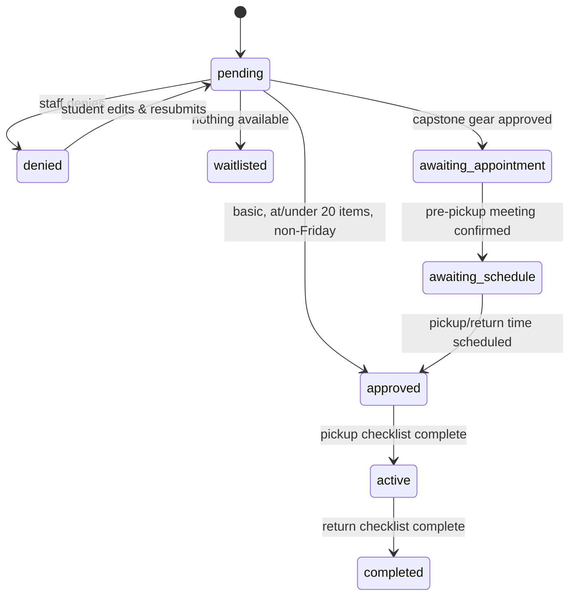

# The Film Cage — Schema Design

September 23, 2026

This reconciles the existing `schema.sql` draft (July 2026, mostly reusable for locations, the academic calendar, and kits) with the data model finalized in the September mockup — the two real structural changes are per-unit equipment tracking and the new Staff / Supervisor / Admin role split.

## Purpose & approach

The `filmCage` repo already had a solid `schema.sql` draft from July 2026 (35 tables), but it was written against the requirements as they stood before the September mockup work — before per-unit inventory, before the Staff/Supervisor split, before the v4 category and scheduling rules. Two changes are structural enough that they touch nearly every table around them:

1. **Per-unit inventory.** The old draft tracks each catalog entry as one row with a `quantity_total` counter and one shared status. The mockup tracks every physical unit individually (`EQ-102-A`, `EQ-102-B`, …), each with its own condition and its own holder. `items` splits into `item_models` (the catalog entry — name, brand, price, category) and `item_units` (the physical inventory).
2. **Role hierarchy.** `user_role` grows from `student / worker / admin / professor` to `student / staff / supervisor / admin / professor`, and every rule that used to check `role = 'admin'` now needs a rank comparison instead of an equality check.

Everything else in the old draft is a good starting point with lighter changes: `locations`, `location_hours`, `semesters`, `academic_calendar`, `course_tier_mappings`, `kits` / `kit_items`, and the notification/strike/fine enums all carry forward with renamed values or a few added columns, not a rebuild.

Table names stay plural and unprefixed (`public.reservations`, not `public.tbl_reservation`), matching the existing draft's own convention.

## Roles, users & access tiers

```sql
CREATE TYPE user_role AS ENUM ('student', 'staff', 'supervisor', 'admin', 'professor');
CREATE TYPE student_tier AS ENUM ('beginner', 'intermediate', 'advanced');
CREATE TYPE strike_reason AS ENUM ('damage', 'late_return', 'behavioral');
```

`public.users` extends `auth.users` as before: `id`, `email`, `full_name`, `role`, `onboarding_completed`, `is_active`, `created_at`, `updated_at`.

`public.student_profiles`: `user_id` (PK), `tier`, `strike_count`, `is_blocked`, `checkout_suspended`, `suspended_at`, `suspended_reason`, `blocked_at`, `blocked_by`, `class_taken` (FK to `course_tier_mappings`), and a new `needs_tier_reconfirmation` boolean — set `true` by the Semester Setup bulk reset, cleared the next time the student logs in and confirms their class.

`public.professor_profiles`: `user_id` (PK), `employment_type` (e.g. "Full-time") — kept minimal since it's display-only today.

`public.student_notes`: `id`, `student_id`, `author_id`, `note_text`, `is_strike`, `strike_reason`, `created_at` — carried over as-is from the July draft.

**Permission summary** (what each tier can do — this is what the RLS/trigger section later maps to actual Postgres enforcement):

| Action | Student | Professor | Staff | Supervisor | Admin |
| --- | --- | --- | --- | --- | --- |
| Browse & reserve equipment | Yes | Yes | Yes | Yes | Yes |
| Approve / deny reservations | — | — | Yes | Yes | Yes |
| Manage catalog, kits, locations | — | — | Yes | Yes | Yes |
| Confirm pickup / return | — | — | Yes | Yes | Yes |
| Downgrade a unit's condition | — | — | Yes | Yes | Yes |
| Upgrade a unit's condition | — | — | No | Yes | Yes |
| Promote / demote a user | — | — | No | No | Yes |
| View full Admin Panel | — | — | Yes | Yes | Yes |

## Locations, hours, academic calendar & Semester Setup

```sql
CREATE TYPE day_of_week_enum AS ENUM ('monday','tuesday','wednesday','thursday','friday','saturday','sunday');
```

`public.locations`: `id`, `name`, `building`, `room`, `address`, `is_active`, `created_by`, timestamps — reused as-is; adding a future location is just a new row.

`public.location_hours`: `id`, `location_id`, `day_of_week`, `is_open`, `appointment_only`, `open_time`, `close_time` — one row per location per weekday, editable per location (the mockup's shared `HOURS` table, made per-location).

`public.academic_calendar`: `id`, `semester_id`, `date`, `is_blocked`, `reason` — school-wide holidays/breaks that block pickup, drop-off, and capstone meetings everywhere. Reused almost unchanged from the July draft.

`public.location_closures` **(new)**: `id`, `location_id`, `date`, `reason`, `created_by`, `created_at` — one-off closures for a single location that aren't holiday-driven ("Studio C closed 10/3 for an AV upgrade"), per your confirmation that closures need to be adjustable per location independent of the shared calendar. A date counts as closed for a location if it appears in `academic_calendar`, in `location_closures` for that location, or if `location_hours` marks that weekday closed.

`public.course_tier_mappings`: `id`, `course_name`, `course_code`, `tier`, `display_order`, `is_active`, `created_by`, `created_at` — the editable class list from Semester Setup, reused as-is.

`public.semesters`: `id`, `name`, `start_date`, `end_date`, `is_current`, `created_at` — reused; `is_current` flips when the "set next semester's start date" checklist step runs.

`public.semester_checklist_items` **(new)**: `id`, `semester_id`, `task_key` (`location_hours` / `closures` / `tier_reset` / `class_list` / `staff_roles`), `is_done`, `done_by`, `done_at` — one row per Semester Setup task per semester. Generic on purpose, since the board only needs to "show a list of tasks" for now, not enforce what finishing each one means.

## Categories & equipment catalog

```sql
CREATE TYPE category_kind AS ENUM ('direct', 'general');
```

`public.categories`: `id`, `name`, `kind`, `display_order`, `is_active` — seeded with the 7 direct categories (Batteries, Cameras, Lenses, Lights, Light Stands, SD Cards, Sound Equipment) and the 3 general ones (Camera Dept, Sound Dept, Misc). Both kinds share one table since they're both just flat named lists.

`public.item_models`: `id`, `name`, `brand`, `model`, `purchase_price`, `picture_url`, `location_id`, `description`, `direct_category_id`, `general_category_id`, `min_tier`, `youtube_url`, `is_active`, `created_by`, timestamps. Direct and general category are two independent picks at creation — not derived from each other — matching your confirmation that Misc is a free choice, not a hardcoded catch-all.

`public.item_custom_attributes`: `id`, `item_model_id`, `attribute_name`, `attribute_value`, `created_at` — reused unchanged, the freeform key/value fields per item.

Dropped from the old `items` table: `status`, `status_notes`, `quantity_total`. All three move to `item_units`, next.

## Per-unit inventory & condition rules

```sql
CREATE TYPE unit_condition AS ENUM ('good', 'caution', 'damaged');
```

`public.item_units`: `id`, `item_model_id`, `unit_code` (e.g. `EQ-102-A`), `condition`, `condition_note`, `is_missing`, `current_reservation_id` (nullable — who holds it right now), `created_at`, `updated_at`.

`public.condition_reviews`: `id`, `unit_id`, `item_model_id`, `reservation_id` (nullable — null for a manual edit outside a return), `student_id` (nullable), `condition`, `note`, `is_reviewed`, `reviewed_by`, `reviewed_at`, `created_at`. A row is created automatically whenever a unit's condition is downgraded, whether that happens through the return flow or a direct manual edit — exactly the mockup's existing flag behavior, just triggered at the database layer so it can't be skipped by a future client that bypasses the app.

**Trigger logic on `item_units`:**

| Situation | Result |
| --- | --- |
| Staff attempts an upgrade (caution/damaged → better) | Blocked — the trigger raises an exception, not just a UI toast |
| Supervisor or admin changes condition, either direction | Allowed, no restriction |
| Any downgrade, any role | `condition_note` required; a `condition_reviews` row is inserted for admin |
| A brand-new unit's initial condition (`INSERT`, not `UPDATE`) | Note still required, but no `condition_reviews` row — there's no prior state to compare against |

Role is read inside the trigger via a `current_user_role()` helper (see RLS section) rather than trusting anything the client sends.

## Kits

`public.kits`: `id`, `name`, `description`, `location_id`, `min_tier`, `created_by`, `is_active`, timestamps.

`public.kit_items`: `id`, `kit_id`, `item_model_id`, `quantity`, `created_at`, unique on (`kit_id`, `item_model_id`). Kits reference item *models*, not specific units — units get assigned at reservation time the same way a directly-added item does.

Carried forward unchanged from the July draft except for adding `min_tier`, to match the per-kit tier gate the mockup already enforces.

## Reservations: fields, lifecycle & scheduling rules

```sql
CREATE TYPE reservation_status AS ENUM (
  'pending', 'denied', 'waitlisted',
  'awaiting_appointment', 'awaiting_schedule',
  'approved', 'active', 'completed'
);
```

`public.reservations`: `id`, `reservation_name` (new, required — the v4 "name your reservation" field), `student_id`, `location_id`, `status`, `is_capstone`, `capstone_appointment_date`, `appointment_completed`, `pickup_date`, `pickup_time`, `dropoff_date`, `dropoff_time`, `scheduled`, `is_group_reservation`, `denial_reason`, `admin_notes`, `created_by`, `approved_by`, `approved_at`, timestamps. No overlap/exclusion constraint on the time range — overlapping reservations across locations are explicitly allowed.

`public.reservation_items`: `reservation_id`, `item_model_id`, `kit_id` (nullable), `quantity`.

`public.reservation_units`: `reservation_id`, `item_model_id`, `unit_id` — the actual assigned physical units, replacing the mockup's in-memory `units[]` array. Populated by a function at auto-confirm or staff-approval time (mirrors `assignUnitsToReservation`).

**Status lifecycle:**



**Scheduling limits:**

| Rule | Value |
| --- | --- |
| Closed days | Saturday, Sunday — never selectable |
| Min lead time, basic reservation | 3 days |
| Min lead time, over 20 items | 7 days |
| Capstone pre-pickup meeting | 3 days min, 2 weeks max |
| Lands on a closed day | Rolls to the next open day |
| Default loan window (basic) | 3 days, pickup → drop-off |

**Approval is required** (status starts at `pending` instead of auto-confirming) when any of: capstone, or over 20 items; any Friday pickup, drop-off, or meeting; a pickup date under 3 days out; or a basic reservation's loan window exceeding the 3-day default (both dates then need approval, not just pickup). A single `BEFORE INSERT OR UPDATE` trigger function computes this and sets `status`, so the app's live pop-up warning and the DB's actual enforcement can't drift apart.

**Editing rights:** a basic reservation stays student-editable any time, as long as the edit still passes the rule above — an edit that breaks it flips `status` back to `pending`. A capstone/over-20-item reservation is student-editable only up to staff approval, enforced by an RLS `UPDATE` policy on `status` + `student_id = auth.uid()`.

Deletion confirmation is a client-side modal, not schema-level — nothing here blocks a `DELETE` at the database layer.

## Crew / group reservations

`public.reservation_crew`: `id`, `reservation_id`, `user_id`, `crew_role` (Producer / Camera Operator / Sound / Gaffer-Lighting / Grip / Editor), `is_producer`, `created_at`. Unlike the mockup, which matches crew by typed name against a hardcoded student list, this is a real FK to `users` — a crew invite is unambiguous.

`public.reservation_assignments`: `reservation_id`, `item_model_id`, `assigned_to_user_id` — which crew member is responsible for which item line, mirroring the mockup's `assignments{}` object.

One thing carried over from the *original* July requirements but never rebuilt into the September mockup: crew members (not just the producer) having their own limited edit rights — their own pickup time, remove-but-not-add items. It's in the requirements doc, not in the current prototype. Flagged in the open questions below rather than assumed either way.

## Pickup & return, fines & holds

`public.checkout_sessions`: `id`, `reservation_id`, `phase` (`pickup` / `return`), `person_user_id`, `person_signature`, `person_confirmed_at`, `staff_user_id`, `staff_confirmed_at` — mirrors the mockup's two-party sign-off (the student or assigned crew member signs, staff confirms separately).

`public.return_item_statuses`: `reservation_id`, `unit_id`, `condition_at_return`, `note`, `is_missing` — per-unit outcomes recorded at return, feeding the `condition_reviews` trigger from the per-unit inventory section.

```sql
CREATE TYPE fine_type AS ENUM ('late_return', 'damage', 'missing', 'other');
CREATE TYPE fine_status AS ENUM ('warning', 'active', 'on_hold', 'resolved');
```

`public.fines`: `id`, `student_id`, `reservation_id` (nullable), `unit_id` (nullable), `fine_type`, `status`, `days_late`, `rate_per_day`, `current_amount`, `escalation_note`, `created_at`, `resolved_at`, `resolved_by`.

**Escalation policy**, from the original requirements doc: first late return gets a warning only, then $5/item/day, escalating to $10, then $25, then checkout privileges are suspended. Modeled as `fine_status` moving `warning` → `active` (rate climbing) → `student_profiles.checkout_suspended = true`, walked daily by a scheduled function rather than one trigger — but the requirements doc doesn't say how many days at each rate before it steps up, so the exact thresholds are a placeholder pending your input (open questions, below).

`public.student_notes` (Roles section) doubles as the strike log — `is_strike = true` rows with a `strike_reason`. The original requirements describe an automatic 3-strike block; a trigger on `student_notes` could flip `student_profiles.is_blocked` at strike 3, but the mockup itself only shows a manual admin action today, not an automatic one — also flagged below.

## Notifications

```sql
CREATE TYPE notification_type AS ENUM (
  'reservation_approved', 'reservation_denied', 'damage_alert', 'fine_issued',
  'waitlist_available', 'crew_invitation', 'strike_issued', 'account_blocked',
  'checkout_reminder', 'return_reminder', 'pre_meeting_scheduled', 'pre_meeting_completed',
  'account_suspended', 'condition_downgrade_flag', 'role_changed', 'tier_reconfirm_needed'
);
```

Carried over from the July draft, with three additions for rules confirmed since: `condition_downgrade_flag`, `role_changed`, `tier_reconfirm_needed`.

`public.notifications`: `id`, `user_id`, `type`, `title`, `body`, `related_reservation_id` (nullable), `is_read`, `channel` (`in_app` / `email`), `created_at`.

Which type goes to email versus stays in-app is a send-time decision made by the Node backend catching Supabase's Database Webhooks, per the confirmed tech stack — this table just records what was generated, for the in-app feed and as an audit trail, regardless of channel.

## RLS & permission enforcement plan

Every table gets RLS enabled. One helper does the role lookup so policies and triggers don't each repeat the same subquery:

```sql
CREATE FUNCTION current_user_role() RETURNS user_role
LANGUAGE sql STABLE SECURITY DEFINER AS $$
  SELECT role FROM public.users WHERE id = auth.uid();
$$;
```

**Row-visibility policies:**

- Students see and edit only their own rows in `reservations`, `reservation_items`, `checkout_sessions`, `fines`, `notifications`.
- Staff, Supervisor, and Admin see all rows across those same tables — writes to `users` / `student_profiles` role and tier fields are restricted further below.
- `item_units`, `item_models`, `kits`, `locations` are readable by everyone — equipment browsing, prices included, is open to all tiers per the original requirements — writable only by Staff, Supervisor, or Admin.

**Trigger-enforced rules** (things RLS alone can't express, since they compare old vs. new values rather than just "who owns this row"):

| Rule | Enforced by |
| --- | --- |
| Staff can't upgrade a unit's condition | `BEFORE UPDATE` trigger on `item_units` |
| Downgrade requires a note + creates a `condition_reviews` row | Same trigger |
| Only Admin can promote/demote to or from Supervisor/Admin | `BEFORE UPDATE` trigger on `users.role` |
| Friday / lead-time / item-count / loan-window approval rules | `BEFORE INSERT OR UPDATE` trigger on `reservations` |
| Editing rights change once a capstone/over-20 reservation is approved | RLS `UPDATE` policy, gated on `status` |

Two Postgres roles the app actually uses: `authenticated` (anon key + a user's JWT — the Vue frontend, subject to every policy above) and `service_role` (the Node backend only, bypasses RLS entirely — used for webhook-driven email sends and any scheduled job like the fine escalation walk, never exposed to the browser).

## Open questions & decisions needed

- [ ] Capstone pre-pickup meetings: Admin-only, or can Staff/Supervisor handle them too? Determines who a trigger or RLS policy allows to mark a meeting completed.
- [ ] Crew member edit rights (own pickup time, remove-but-not-add items): keep from the original requirements doc, or drop since the September mockup never rebuilt it?
- [ ] Fine escalation day-thresholds: how many days at $5/item/day before it steps to $10, then $25? Not specified anywhere yet.
- [ ] 3-strike auto-block: should hitting 3 strikes automatically set `student_profiles.is_blocked`, or stay a manual admin call, which is what the mockup shows today?
- [ ] "Missing" as a unit state: the mockup's condition dropdown only has Good/Caution/Damaged, but the original requirements also describe a separate "missing" tag staff can apply to an unreturned unit. Its own condition value, or a separate `is_missing` boolean alongside condition (as drafted above)?
- [ ] Waitlist promotion: when a unit frees up, does a waitlisted reservation move automatically, or does staff have to act on it?
- [ ] Recurring professor reservations: the July draft's `recurring_reservations` / `recurring_reservation_occurrences` tables look solid and the mockup only has placeholder text ("Recurring" / "Tuesdays") — OK to carry those two forward mostly as-is?
- [ ] Anything else from client feedback mentioned in passing but not detailed yet in the project notes?

Once these are settled, this becomes the actual migration files in `supabase/migrations/`.
